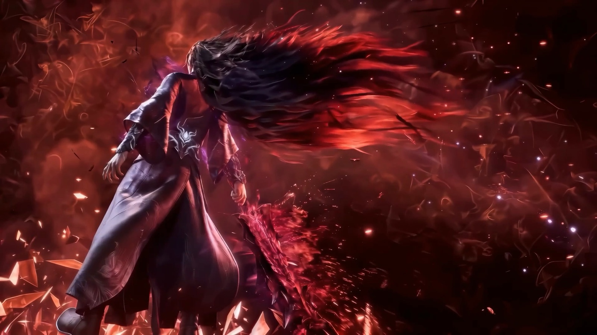

# 凡人·朱煞 · Fanren · Crimson Omen

一个 DeepSeek Harness（DSH）Web 界面主题插件：把仙侠视频《凡人》设为整幅动态壁纸，并换上朱砂与墨色交织的「凡人·朱煞」配色。

仓库：<https://github.com/luozone001/dsh-fanren-theme>



A DSH Web GUI theme plugin: the supplied xianxia clip as a full-window motion wallpaper, plus the vermilion-and-ink *Fanren · Crimson Omen* palette.


## 安装 / Install

### 方式一：从 GitHub 安装（推荐）

1. 打开 DSH 侧边栏的 **Plugins**（插件）页，点 **Add plugin**（添加插件）。
2. 把下面这行粘进输入框，点 **Install**：

   ```text
   https://github.com/luozone001/dsh-fanren-theme.git
   ```

3. 安装完成后打开 **Settings → 凡人·朱煞**（设置 → 凡人·朱煞）。首次加载会自动开启壁纸与配色。

需要固定版本时使用 `https://github.com/luozone001/dsh-fanren-theme.git#v1.0.0`。

> 安装时 DSH 需要能访问 GitHub（pnpm 会克隆仓库，并一起拿到 19 MB 壁纸）。要求 DSH 0.2 内核（0.2.2-rc.3 已验证）与 Node.js 22.12+。

### 方式二：本地目录

```sh
git clone https://github.com/luozone001/dsh-fanren-theme.git
```

在 **Add plugin** 中填写克隆目录的绝对路径（也可以点选本地目录）。以 `link:` 方式安装时，请勿移动或删除该目录。

<details>
<summary>Web / CLI 安装</summary>

非 Desktop 的 Web profile 可以用 CLI 一步安装（命令会同时把 bundle 加入 profile 的 `dsh.profile.bundles`）：

```sh
dsh plugin --profile web add https://github.com/luozone001/dsh-fanren-theme.git
```

Desktop 的 profile 由桌面 app 独占，请在 app 内的 **Plugins** 页安装，不要用 CLI 改 desktop profile。

</details>

### 关闭 / 卸载

在 **Plugins** 页找到 **凡人·朱煞**（包名 `@local/fanren-theme`），关闭会立即移除壁纸与配色，卸载会连同包一起移除。

## 功能 / What it does

- **整幅动态壁纸**：视频铺满窗口，位于三栏界面之后；静音循环、自动播放，窗口隐藏时暂停省电。默认墨色遮罩 46%、景深模糊 6px，均可在设置页实时调整。
- **「凡人·朱煞」配色**：以 DSH 的主题令牌叠加层（`ctx.theme.overrideTokens`）实现：朱砂主色 `#e2665a`、墨底半透明面板、温白文字、暗金状态色。它**不修改你的外观主题偏好**，关闭开关即恢复原来的浅色/深色/系统设置；切换浅色或深色也不会把配色悄悄关掉。
- **独立设置页**：设置 → **凡人·朱煞**。开关壁纸、调整遮罩与模糊、开关配色、恢复默认；页内预览与实时效果一致（含遮罩和模糊），带播放/暂停控制。
- **省电与无障碍**：窗口隐藏在后台时暂停播放；系统「减少动态效果」开启时只显示静帧，预览也默认暂停。
- **HTTP Range 流式供给**：宿主从包内 `assets/fanren-wallpaper.mp4` 读取并支持单段 Range、`If-None-Match`、`HEAD`，首屏不必等整段 19 MB 下载完。

## 设置项 / Settings

| 设置 | 默认 | 说明 |
|---|---|---|
| 动态壁纸 | 开 | 关闭后立即移除壁纸图层，配色保留 |
| 墨色遮罩 | 46% | 0–85%，加深暗部以保证文字可读 |
| 景深模糊 | 6px | 0–24px，0 为原片清晰度 |
| 凡人配色 | 开 | 叠加令牌层，不改外观主题偏好；关闭即恢复原来的外观主题，切换浅色/深色也不会自动关闭 |

设置保存在当前浏览器的 `localStorage`（键 `dsh-fanren-theme.settings.v1`），同一 origin 的其它窗口通过 `storage` 事件同步；插件每次加载时据此恢复壁纸与配色。外观主题偏好仍由 DSH 设置文档保存，本插件只叠加/移除令牌层。

## 壁纸素材 / Wallpaper asset

原始文件为 4K 60fps（3840×2160、14.8 秒、无音轨）。为降低后台解码开销，包内保存的是转码副本：

- `assets/fanren-wallpaper.mp4`：1920×1080、30fps、H.264、无音轨、`moov` 前置（faststart），约 19 MB
- `assets/fanren-poster.jpg`：1600×900 首帧海报，用于视频加载前的占位与失败兜底

如要换回原画或其它视频，直接替换 `assets/fanren-wallpaper.mp4` 即可（保持同名，注意浏览器需要能解码的编码）。路由每次请求都会重新读取文件，ETag 以大小与修改时间生成，替换后浏览器会自然取到新内容，无需重启。**素材来源于用户本机文件；本仓库随附仅用于个人安装这个主题。视频与角色素材版权归原权利人，若权利人要求会移除，再分发或商用前请自行确认授权。**

## 实现 / Implementation

```
fanren-theme/
├── index.js            宿主半：/fanren-theme/{wallpaper.mp4,poster.jpg,status} 三条只读路由（Range/HEAD/ETag）
├── client.js           客户端半：配色令牌层、壁纸图层、设置页与图标
├── cordis.patch.yml    插入 fanren-theme 行
├── assets/             转码后的壁纸与海报
├── docs/               插件详情页图文
├── locale/             插件元数据（中文/英文）
└── icon.svg            插件图标
```

- 配色通过 `ctx.theme.overrideTokens('@local/fanren-theme', …)` 叠加为令牌层，开关即添加/移除该层；不调用 `setTheme`，因此不会与外观选择互相覆盖。半透明底让壁纸透出，`html[data-fanren-palette]` 同时固定原生控件的深色方案。
- 壁纸图层是插入 `document.body` 的 `<video>`（`#root` 之上、`z-index` 之下），因为没有位于三栏之后的 DSH 插槽；它在 `ctx.effect` 内创建并在卸载时完整移除，含样式表、属性、视频、手势重试与各类监听器。
- 全局样式（墨底、`#root` 层叠修正）只在「壁纸或配色任一开启」时生效；两者都关时界面回到宿主原样。
- 设置页注册在 `settings.section`，导航图标注册在 `settings.section.icon`；文案走 Client locale 服务（zh/en）。
- 宿主路由仅暴露包内固定两个文件，不读取任意路径。
- `GET /fanren-theme/status` 是可读诊断：列出两个素材是否存在、字节数，并回显浏览器最近一次上报（配色是否激活、壁纸是否挂载、视频状态、视口尺寸）。上报只存在进程内存、不落盘。
- Desktop 外壳用 `dsh-app://app/` 加载页面时，相对路径请求由应用协议转发到本机 Web 服务器，所以同一套相对 URL 在 Web 与 Desktop 下都可用。

## 已知限制 / Limits

- 壁纸依赖宿主 `webServer` 路由；在以 `file://` 加载页面的纯原生外壳（无 Web 服务器）里，视频请求不可达，此时只剩配色，设置页会显示“宿主未提供壁纸路由”。
- 壁纸设置按浏览器保存，不做宿主端同步；换浏览器需要重新调整。
- 视频是 1080p30 转码副本，不是原始 4K 码流；对后台播放性能的取舍见上文。设置页不再显示写死的分辨率，避免替换素材后标注过时。
- macOS 的窗口通透（vibrancy）会被本主题的墨底覆盖，这是为了让半透明面板有稳定的暗底。

## 许可 / License

代码以 MIT 许可发布；壁纸视频与海报为第三方素材，不在 MIT 覆盖范围内，详见 [NOTICE.md](NOTICE.md)。再分发或商用前请自行取得授权。
